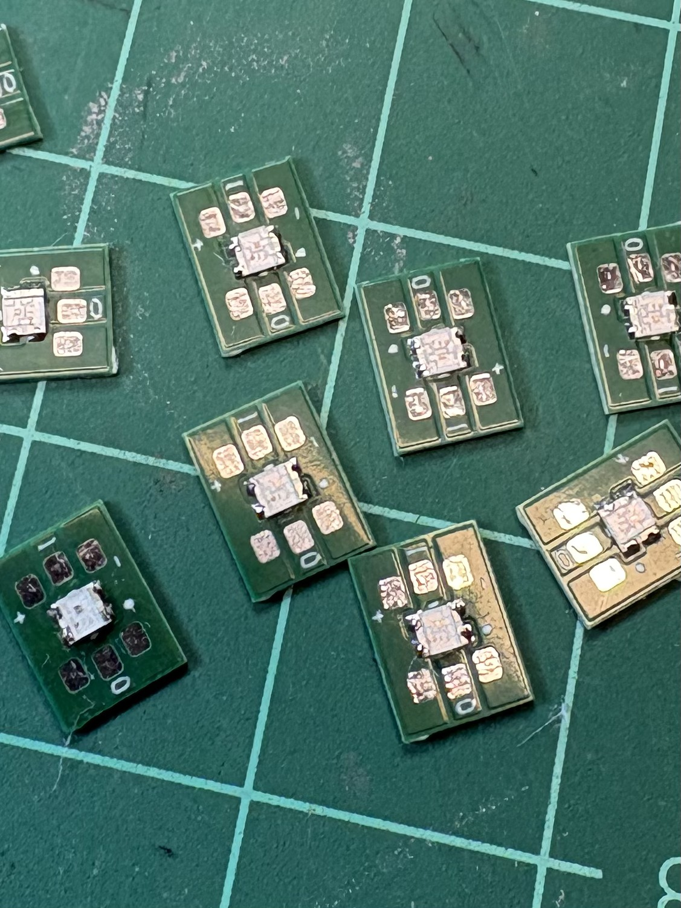

# Led2020 — WS2812B-2020 carrier board (rave glove LED bead)

A tiny ~9 × 7 mm carrier PCB that turns a single WS2812B-2020 addressable RGB LED
into a solderable "bead": the LED's four pads are brought out to **six 0.7 mm wire
holes** (3 on each end, 5 V / DATA / GND), so boards chain input-to-output with
30 AWG silicone wire.

Designed in EAGLE for the [Motion-Reactive LED Rave Gloves](https://www.instructables.com/)
project: 20 of these per glove, four per finger, five independent chains, sealed
under UV resin and worn to raves.

## Ordering

- Send the `Gerber file, CAMOutputs` folder (zipped) to any PCB fab
  (JLCPCB, PCBWay, OSH Park, ...).
- 2-layer, any colour. 1.6 mm works; 1.0 mm flexes nicer over knuckles.
- Qty: 4 boards per finger — 20 per glove, order 40+ with spares for a pair.
- BOM: 1× WS2812B-2020 per board (Worldsemi), nothing else.

## Silkscreen

- `I` / `O` marks the data direction: wires come IN one end, OUT the other.
- `+` corner marks LED pin 1 / polarity.

## Licence

CC-BY-SA 4.0 — build them, sell them, improve them, just share alike and credit.

---

*Part of the Motion-Reactive LED Rave Gloves project by YannickTurcotte.*
